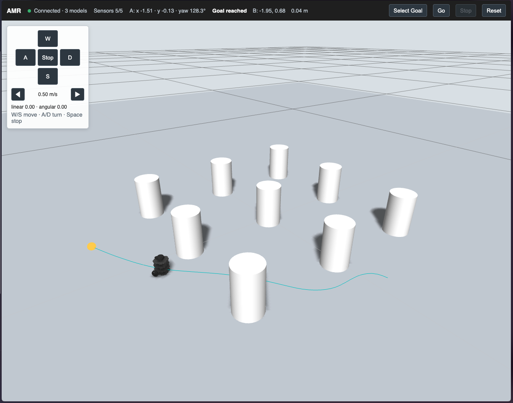

# Robot Simulation + Web Control

This repository provides a browser-integrated simulation environment for a
differential-drive robot. It combines a Gazebo Jetty simulation, a FastAPI
control and telemetry server, and a web interface for observing and
controlling the simulated robot.

The project is intended for simulation and web integration, navigation
experiments, and deterministic end-to-end testing. It is not a machine
learning or reinforcement-learning training pipeline; it does not contain
training loops, datasets, or model-training code.



## Run with Docker

Requirements: Docker and Docker Compose. No local Gazebo or `uv` installation
is needed.

```bash
docker compose up --build
```

Open <http://localhost:8010>.

## Reeman robot18 với ROS Noetic gốc

### Run port 8020 from Docker Hub

Clone this repository and use Docker Compose with an x86-64 Linux Docker
engine. On Windows, use Docker Desktop in Linux containers mode. Run this
from the root of the checkout:

```bash
docker compose -f docker-compose.reeman.yml up --wait
```

Open <http://localhost:8020>. Compose pulls the Noetic runtime and Gazebo
images from `nguyenhoangnguyen/reeman_code`. If the registry requires
authentication, run `docker login` with an account that has pull access.
The simulator loads its launcher, bridge, and web UI from the Git checkout.
The simulated room uses its own Docker volumes for maps and routes.

```bash
docker compose -f docker-compose.reeman.yml down
```

### Docker Compose with a local backup

On Windows, enable Docker Desktop integration with Ubuntu WSL and run from the
repository directory in Ubuntu:

```bash
docker compose --profile reeman up --build --wait reeman-gazebo
```

Open <http://localhost:8020>. The viewer connects to Gazebo on port 9012.
This starts Gazebo Jetty and the original ROS Noetic stack in separate
containers. The default world is the test room. Set `REEMAN_WORLD=map` before
running the command to use the backed-up map.

Set `REEMAN_BACKUP_DIR` to the Linux path of the extracted Reeman Ubuntu 20.04
filesystem on your machine. On this workstation it defaults to
`/mnt/d/Embedded_Backup/ubuntu_root_full`. If you have a prepared copy of
`/opt/ros/noetic` and the two Reeman workspaces, point `REEMAN_RUNTIME_DIR` at
that directory. The backup and runtime are mounted read-only. The
`reeman-data` volume stores writable map and route data by world.

```bash
docker compose --profile reeman ps
docker compose --profile reeman exec reeman-noetic tail -f /sim-state/ros.log
docker compose --profile reeman stop reeman-gazebo reeman-noetic
```

Stop both Reeman services before rebuilding an active session so the Gazebo
bridge and ROS master start together.

### Ubuntu WSL launcher

The Reeman mode uses the WSL harness in `src/reeman/harness`. It launches the
deployed Noetic nodes from the read-only backup with a writable copy of the map
data.
The Gazebo world uses the map from the Reeman backup by default. Pass
`--room` for the simple test room.
The room uses its own static occupancy grid for navigation and starts a
fresh Reeman Cartographer trajectory at startup. The backup's saved trajectory
belongs to a different layout and is kept outside the room's ROS map directory.

From PowerShell in the project directory:

```powershell
$repo = (Get-Location).Path
wsl -d Ubuntu --cd "$repo" -e bash src/reeman/run.sh
```

Open <http://localhost:8010> for the AMR 3D interface connected to Reeman's
Gazebo world and ROS Noetic stack. Manual drive uses the original mux.
Planning and A-to-B goals use the original `move_base` node. The sensor
panel and 2D map read the ROS feeds. Stop the standalone Compose stack before
launching this mode because both use ports 8010 and 9002.

**Tạo bản đồ mới** starts a separate session using the Reeman Cartographer
binary and its SLAM configuration. It uses the same ROS scan and EKF odometry
as the running robot and publishes the new grid on a session-specific topic.
The 2D map opens beside the Gazebo view and shows the robot heading and
LiDAR rays from the active mapping session. Scans are transformed into the
grid frame at their acquisition time.
Export saves the displayed grid as JSON. The active navigation map remains
the one supplied by the original Reeman bringup.

`REEMAN_HARNESS` can override the bundled harness. Set `REEMAN_BACKUP` to the
extracted Reeman filesystem (default `/mnt/d/Embedded_Backup/ubuntu_root_full`).
`REEMAN_RUNTIME` can point to a prepared Linux copy of its Noetic and Reeman
workspaces. The WSL launcher requires Bubblewrap (`bwrap`), Gazebo Jetty and
its `gz.transport` and `gz.msgs` bindings for `/usr/bin/python3`.
`REEMAN_HTTP_PORT` overrides 8010 and `REEMAN_GZ_PORT` overrides 9002.

For a second session on port 8020, start the same launcher with
`REEMAN_HTTP_PORT=8020 REEMAN_GZ_PORT=9012 bash src/reeman/run.sh --room`
from WSL. Each session has its own Gazebo partition, ROS master and map files.

In this profile, Gazebo provides range data to the original HINS-HE driver
over loopback TCP and IMU data to the original WIT901 driver through a
pseudo-terminal. The HINS driver runs on an isolated wall-clock ROS master.
Its decoded scan is relayed onto the main ROS graph with the original
Gazebo sample timestamp. Hardware parameter writes are disabled for the
simulated HINS device. The Gazebo base bridge publishes raw wheel odometry
to `/mobile/odom`. The original EKF consumes it and `/imu` and publishes
`/odom`. The dashboard supports WASD and the arrow keys.

The 8020 profile also selects the virtual OpenNI2 depth device and launches
the original Astra ROS node. It accepts the Gazebo 320 × 160 stream as
16-bit millimetre frames and supplies camera intrinsics derived from the
Gazebo field of view. It implements depth acquisition at the OpenNI2 API.
`REEMAN_OPENNI_INPUT=0` selects the earlier Gazebo camera topic adapter.
The endpoint `/api/base/odometry` reports the raw and filtered odometry.

### Original drivers with a different base endpoint

`src/reeman/native_base_launch.py` stages the original Reeman launch files
and overrides only the `mobile_base` parameter `device_port`. It keeps the
original nodelet, baud rate, sensor launches, EKF and ROS remaps. The input
serial device or PTY must already be backed by a controller compatible with
the Reeman base driver. The staging tool does not implement that controller.

Run the generated `yoyo_robot_native.launch` on a compatible Noetic host
with the original Reeman setup and model environment sourced, and with the
HINS-HE, IMU and Astra available to the original drivers. Keep this launch
separate from the Gazebo bridge so there is only one publisher for the raw
sensor and base topics. Port 8020 currently runs the Gazebo test profile.

Gazebo provides the input topics normally supplied by HINS-HE, WIT901, Astra
and the mobile base. The Reeman harness omits the hardware-only driver
launch entries and keeps the original filters, EKF, Cartographer, costmaps,
navigation, safety and application nodes. The test dashboard exposes a
subset of Reeman controls. Automatic physical docking needs simulated dock
signals, and the dashboard does not currently expose the OEM route editor,
virtual-wall editor or relocation.

Stop the simulator:

```bash
docker compose down
```

Useful commands:

```bash
docker logs -f amr-app
docker compose exec amr bash
```

## Tests

Run the normal test suite:

```bash
docker compose run --rm amr uv run python -m unittest discover -s src/tests -p 'test_*.py'
```

Run the 12-case Gazebo navigation smoke test:

```bash
RUN_GZ_SIM_SMOKE=1 docker compose run --rm amr uv run python -m unittest src/tests/test_amr_navigation_sim_smoke.py
```

## Controls

- `W` / `S`: forward / backward
- `A` / `D`: turn left / right
- `Space`: stop
- Select a goal on the map, then press `Go` for autonomous navigation.

The service uses image `amr-app:latest` and container `amr-app`.

## Reeman sensor checks

The **Cảm biến Reeman** panel shows the scan, IMU readings, and a depth image
next to the existing 3D viewer and navigation controls.

| Sensor | Gazebo Transport | Profile |
| --- | --- | --- |
| HINS-HE | `/amr/reeman/scan` | 10 Hz, 240° at 0.1° intervals, 0.05–50 m |
| WIT901 | `/amr/imu` | 50 Hz, orientation, angular velocity and linear acceleration |
| Astra Max | `/amr/camera/depth_image` | 320 × 160 at 10 Hz, 0.12–6 m |

The RGB-D sensor also exposes `/amr/camera/image`, `/amr/camera/points`,
and `/amr/camera/camera_info` through Gazebo Transport.
Use `GET /api/sensors` to check readings and sample age. `GET /api/sensors/depth`
returns the original float32 little-endian depth pixels in meters with
`X-Depth-Width`, `X-Depth-Height`, and `X-Depth-Step` (bytes per row).

The LiDAR test profile is separate from the 360-ray planner input on
`/amr/scan`. The planner scan runs at 10 Hz to stay fresh when headless
rendering slows simulation time. The Astra parameters match the Reeman lab
approximation. This
project runs native Gazebo sensors and does not load the ROS Noetic Reeman
driver binaries.

## Bản đồ điều hướng 2D

Open **Bản đồ 2D** in the dashboard. The view uses the existing static
`amr_world.json` map and shows the live Gazebo pose and current planned path.

- Select **Chọn waypoint** and click the destinations in travel order. Choose
  **Lập tuyến**, then **Chạy tuyến**. The navigator plans each leg in order and
  retains velocity control between legs. **Dừng** cancels the entire mission.
- Select **Vẽ tường ảo** and click both endpoints of each wall. **Áp dụng tường**
  adds the segments to the planning grid and inflates them using the same
  clearance as static obstacles. Stop the current mission before applying
  changes. To remove all walls, clear the draft and apply it.

Waypoints are a browser draft and applied walls live in server memory for the
current simulation session.

### Dựng bản đồ mới bằng Cartographer

Run `docker compose --profile slam up --build` to start Gazebo and the ROS 2
Humble Cartographer sidecar. Open **Bản đồ 2D → Tạo bản đồ mới → Bắt đầu bản đồ
trắng**. Hold the drive buttons to explore. The panel begins in the unknown
state and shows the 5 cm occupancy grid as Cartographer publishes it. Use
**Dừng quét** to keep the latest received grid and **Tải bản đồ JSON** to export
its cells, dimensions, origin and resolution. Unknown cells are `-1`.

Each mapping session starts a fresh Cartographer trajectory. The sidecar uses
the simulated HINS-HE scan, Gazebo wheel odometry, and the LiDAR mounting
transform. It uses Gazebo simulation timestamps and the 2D configuration
without a direct IMU input. Avoid resetting Gazebo during an active mapping
session because it resets the sensor clock.

The JSON export is an occupancy grid snapshot. Importing it into the existing
waypoint planner and localizing against it are separate from this mapping flow.
